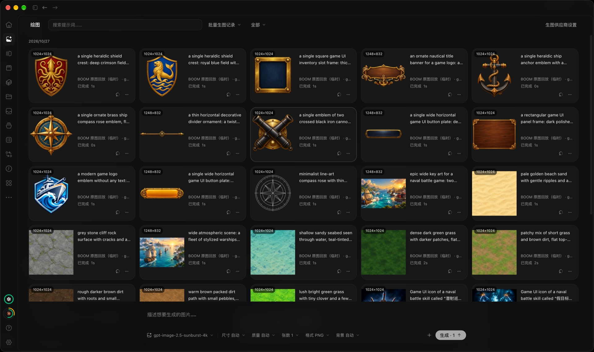
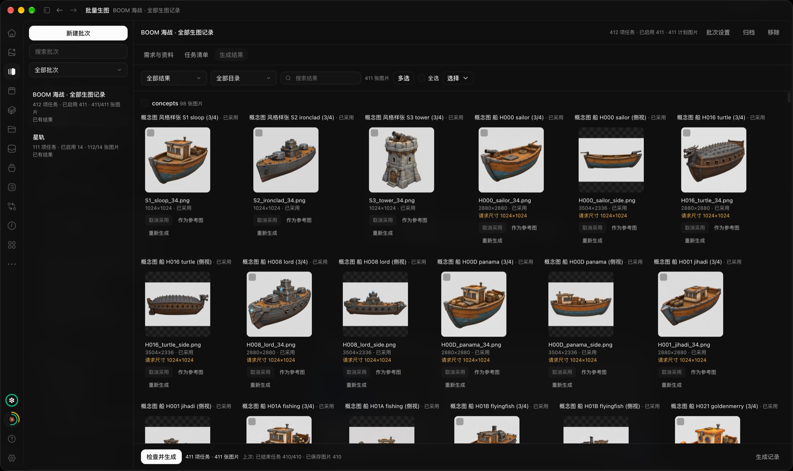
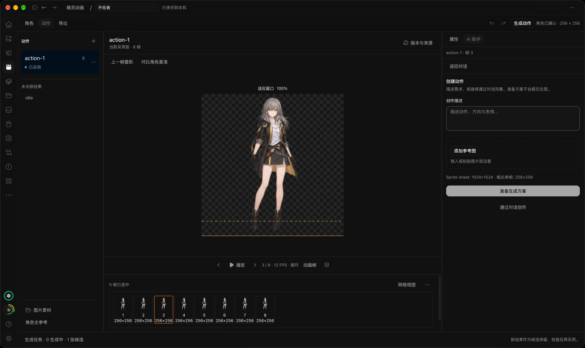
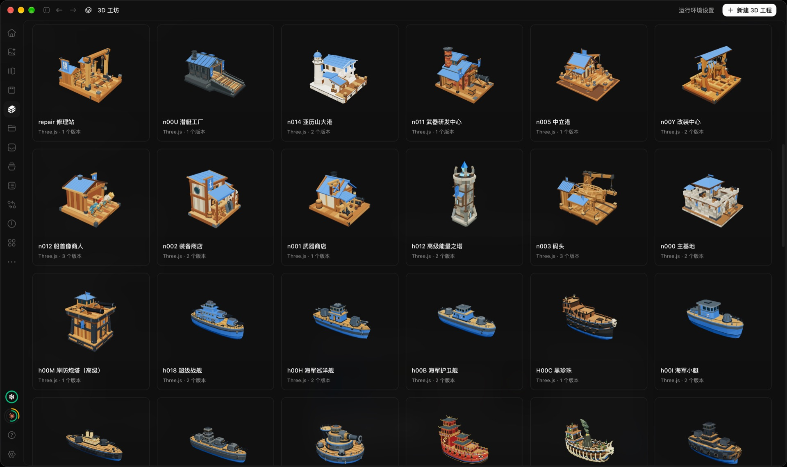
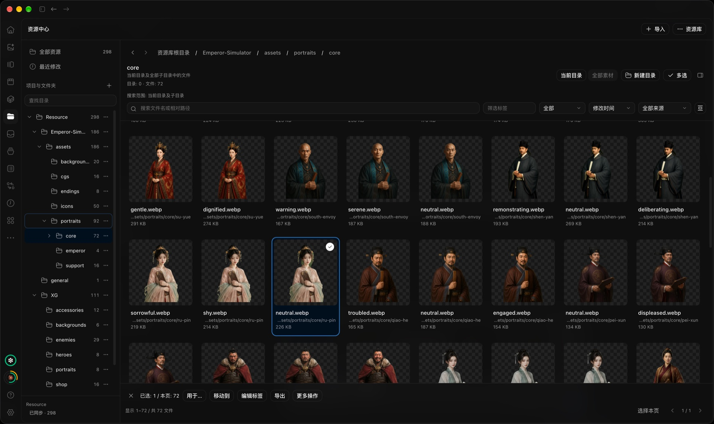
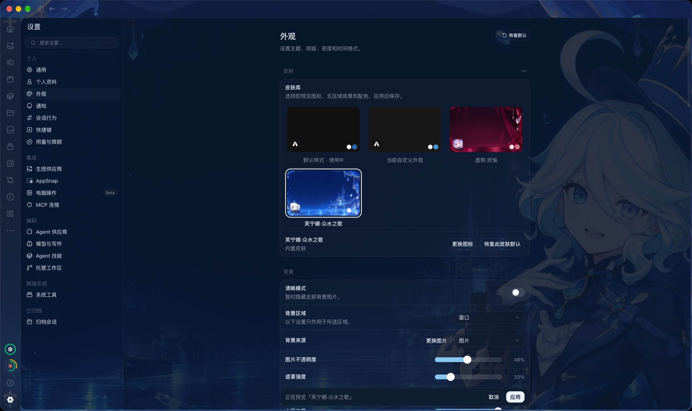

<div align="center">
  
  <h1>Aha</h1>
  <p><strong>把编程、绘图与游戏素材创作，放进同一个本地 AI 工作台。</strong></p>
  <p>编程 Agent · 绘图 · 批量生图 · 精灵动画 · 3D 工坊 · 资源管理</p>
  <p>
    <a href="#特色功能">特色功能</a> ·
    <a href="#开发与构建">开发与构建</a> ·
    <a href="docs/README.md">使用文档</a> ·
    <a href="UPSTREAM.md">上游来源</a> ·
    <a href="LICENSE">MIT License</a>
  </p>
</div>

Aha 是基于 [Synara](https://github.com/Emanuele-web04/synara) 二次开发的本地编程 Agent 工作台，面向日常开发与游戏素材制作。它保留项目与聊天、供应商会话、Git、编辑器、终端、浏览器及自动化，并加入中文界面和一组相互衔接的创作工具。

你可以从对话整理需求，批量制作素材，再挑选结果、制作动画或模型，最后收进项目资源库。各项 AI 能力需配置相应的供应商、账号与本地运行环境。

## 特色功能

### 绘图：从一张参考图开始创作

描述需求或添加参考图，选择生图供应商、模型、尺寸、质量、格式与背景，直接生成图片。历史记录支持搜索、预览、复用参数、标注和局部重绘，方便继续修改已有结果。



### 批量生图：把整套素材需求变成任务清单

将需求、文档和参考图交给批次对话，先审阅 AI 整理的任务方案，再确认生成。批次风格和参考图帮助统一视觉方向；结果按目录与任务组织，可挑选采用、单独重新生成、批量导出或加入资源中心，适合成套制作图标、立绘、场景与 UI 素材。



详细流程见 [批量生图指南](docs/guides/IMAGE_BATCHES.md)。

### 精灵动画：从角色基准到可导出的动作

围绕「角色 → 动作 → 导出」制作插画或像素动画。确认角色基准后生成动作，在画布中逐帧播放、叠影对照、切帧和调整对齐；检查并采用候选后，导出 PNG 序列、动作图集与动画元数据，也可保存可编辑的工程包。



详细流程见 [精灵动画指南](docs/guides/SPRITE_WORKFLOW.md)。

### 3D 工坊：用对话迭代游戏道具

通过 Three.js 或 Blender MCP 制作静态 3D 道具，在本地构建并预览真实模型。工程保留候选版本，可旋转检查模型、调整参数与 PBR 材质、采用或回退版本，并导出 GLB 或 Godot 资源包。



详细流程与运行环境要求见 [3D 工坊指南](docs/guides/MODEL3D_WORKSHOP.md)。

### 资源中心：按项目整理，让素材继续流转

映射本地资源目录，用目录树、搜索、标签与来源筛选浏览素材，支持预览、多选、移动和导出。图片可送入聊天、绘图、批量生图或精灵项目；生成结果与导出资源可手动入库，并保留来源，方便回到对应工作台继续创作。



详细操作见 [资源中心指南](docs/guides/RESOURCE_CENTER.md)。

### 个性化外观：让工作台有自己的样子

内置皮肤库，支持预览后应用，自定义图标、五个界面区域的背景与配色，并调整图片不透明度和遮罩强度。搭配明暗主题、界面语言和字号设置，也可随时开启「清晰模式」暂时隐藏背景图片。



## 开发与构建

需要 Bun **1.4.2**、Node.js **24.13.1** 及对应平台原生工具链；macOS 原生构建需要 Xcode。

```sh
bun install --frozen-lockfile
bun run aha:dev
```

构建源码与本地打包：

```sh
bun run aha:build
bun run aha:package
```

`aha:package` 默认构建 macOS Apple Silicon（arm64）正式版，整体替换 `release/mac-arm64/`，产物为 `release/mac-arm64/Aha.app`，并做 ad-hoc 签名。其他平台的本地构建入口见根 [package.json](package.json)。

<details>
<summary>Cua Driver 构建与缓存</summary>

构建 Cua Driver 需要 Rust **1.97.1**。未设为默认工具链时运行：

```sh
RUSTUP_TOOLCHAIN=1.97.1 bun run aha:package
```

首次构建后结果按固定版本缓存在 `~/Library/Caches/aha/cua-driver`，可用 `AHA_CUA_CACHE_DIR` 指定位置。后续打包校验后直接复用，无需再访问 GitHub；删除该缓存目录即可强制重建。

</details>

<details>
<summary>核心回归与源码检查</summary>

```sh
bun run test
bun run --cwd apps/web test:browser
bun run typecheck
bun run fmt:check
bun run lint
```

绘图、批量生图和精灵本机 E2E 需要显式指定独立测试服务与本机 mock；普通测试运行会跳过这些项目。相关入口见 [创作功能维护](docs/development/CREATIVE_WORKBENCHES.md)。

</details>

## 设置与数据

先安装并认证准备使用的供应商运行时，再在 Aha 设置中选择账号、供应商和模型。生图渠道在 **设置 → 生图供应商** 中配置，皮肤、背景、主题和界面语言在 **设置 → 外观** 中调整。

| 场景                  | 默认数据目录                           |
| --------------------- | -------------------------------------- |
| 正式应用              | `~/.aha-next`                          |
| 本地开发（`aha:dev`） | 仓库内 `.aha-dev`                      |
| 独立服务              | 可通过 `AHA_HOME` 或 `--home-dir` 指定 |

Aha 使用独立应用身份与 `aha-next:` 协议，关闭官方 Synara 自动更新、渠道安装和诊断上传。

## 文档入口

| 文档                                       | 内容                               |
| ------------------------------------------ | ---------------------------------- |
| [文档目录](docs/README.md)                 | 功能指南与开发约定                 |
| [批量生图](docs/guides/IMAGE_BATCHES.md)   | 需求编排、任务执行、结果挑选与入库 |
| [精灵动画](docs/guides/SPRITE_WORKFLOW.md) | 角色、动作、修帧、导出与恢复       |
| [3D 工坊](docs/guides/MODEL3D_WORKSHOP.md) | 建模、候选版本、材质与导出         |
| [资源中心](docs/guides/RESOURCE_CENTER.md) | 目录、搜索、预览与素材整理         |
| [UI 实现规则](docs/UI_GUIDELINES.md)       | 公共布局、控件、主题与交互规范     |
| [上游来源](UPSTREAM.md)                    | 固定版本、合并记录、兼容与精简边界 |

## 来源与许可

Aha 当前源码已合入 **Synara v1.0.7**，保留上游 Git 祖先关系、内部包名及兼容标识。感谢 [Synara](https://github.com/Emanuele-web04/synara) 及其贡献者，版本与迁移信息见 [UPSTREAM.md](UPSTREAM.md)。

项目采用 [MIT License](LICENSE)。原生 CUA 组件遵循 [CUA 许可证](licenses/CUA-LICENSE.txt)，绘图组件的第三方声明见 [gpt-image-playground](third-party-licenses/gpt-image-playground.txt)。
