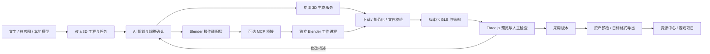

# Aha 3D 工坊：产品说明与技术可行性

状态：**待评审方案，尚未实现正式功能**。研究日期：2026-10-20。本文中的模型、数字及界面均为说明交互的示例，不代表真实生成质量、服务报价或已完成的引擎适配。

## 1. 产品定位与建议

在 Aha 最左侧主导航中新增「3D 工坊」，放在「精灵动画」之后、「资源中心」之前；沿用现有导航的排序、隐藏与当前路由高亮规则。为独立开发者提供从文字或参考图出发，生成、修改、检查、保存和导出游戏 3D 道具的一站式工作台。

核心承诺：**把想法变成可以继续编辑、经过检查并能导入目标游戏引擎的资产**。首版以静态道具为主，不将“生成出一个能预览的模型”等同于“已达到游戏生产质量”。

建议采用可组合的三段架构：

1. **AI 负责理解与规划**：把描述转成对象规格，选择生成方式，解释修改范围。
2. **生成后端与 Blender 负责模型文件**：简单规则形状可以由 AI 驱动 Blender 建模，复杂物体可以由专用 3D 服务生成；必要时交给 Blender 整理、烘焙、减面和转换。
3. **Three.js 负责 Aha 内预览**：加载规范化的 GLB，进行旋转、缩放、材质和线框检查；导出前仍以真实文件及目标引擎验证为准。

“AI → Blender MCP → Blender”是一条成立的实现路径，但 MCP 是工具通信层，不是生成模型本身。建议将 Blender 操作封装在 Aha 的适配层中，避免产品工作流直接依赖某个社区 MCP 的全部工具或返回结构。

## 2. 目标用户与典型任务

| 用户 | 任务 | 首版价值 |
| --- | --- | --- |
| 独立游戏开发者 | 为场景补充宝箱、武器、路灯、石块、家具 | 快速拿到尺寸与预算可控的静态资产 |
| 程序型创作者 | 用自然语言修改低多边形或几何道具 | 保存可重复执行的构建步骤和可编辑源文件 |
| 有现成素材的开发者 | 导入 GLB，在不重新生成的前提下检查和导出 | 本地预览、统一规格、打包与来源追踪 |

示例任务：“生成一个低多边形木制宝箱，约 1 米宽，适合俯视角 RPG；预算 5,000 三角面，贴图不超过 2K，底部中心为轴心。”

一轮工作应能完成：描述或选图 → 确认规格与费用 → 生成候选 → 多角度检查 → 保留或修订 → 采用一个版本 → 导出与写入资源中心。

## 3. 首版范围

### 首版必须具备

- 独立模块入口、项目列表、本地工程保存与重新打开。
- 文本入口；选定供应商支持时提供图片入口，允许从资源中心选择参考图。
- 首先打通一条真实生成链路；推荐用 AI + Blender 生成几何道具作为技术验证，面向广泛物体生成的 MVP 再接入一个经过样本验证的专用服务。两种生成方式可分阶段交付，不同时接入全部供应商。
- 本地 GLB/glTF 导入，不依赖生成服务；导入后检查外部资源是否齐全。
- Three.js 预览：旋转、缩放、平移、重置视角、材质/实体/线框模式、网格与包围盒。
- 实际三角面、顶点、材质槽、贴图尺寸、包围盒尺寸与文件体积统计；未知数据明确显示未知。
- 候选、已采用版本、派生处理版分离，非覆盖修改，可回退。
- 最低导出闭环：通用 GLB + 贴图/清单/检查报告，以及 Godot 的 GLB 导入验证。
- 需要 Blender 的功能才要求安装 Blender；查看已有 GLB 不要求安装。
- 任务阶段、失败原因、重试、取消语义，以及重启后的任务恢复。

### 在首版闭环成立后增加

- Blender 内定向修改、尺寸/轴心规范化、减面、UV/烘焙与基础 LOD。
- Unity / Unreal 的 FBX 与贴图导出预设，并对固定引擎版本完成导入验证。
- 简单碰撞代理；明确它是独立几何，不是改一个文件名就自动成为引擎碰撞体。
- 材质与颜色局部修改、多版本并排比较、批量道具制作。
- 将模型多视角渲染图送入现有绘图/精灵流程，形成创作联动。

### 后续单独立项

人物生产拓扑、自动骨骼/权重、动作生成与重定向、表情、毛发/布料、复杂场景编辑、专业雕刻与顶点编辑。第三方服务提供相应 API，不代表 Aha 已经具备可靠的人物动画生产能力。

## 4. 界面结构

沿用现有精灵工作台的结构：应用顶栏与主导航 → 工程流程 → 左侧对象/版本 → 中央预览 → 右侧属性/AI 助手 → 底部任务状态。3D 工坊独占内容区，避免额外保留会话侧栏导致四五列挤压。

| 区域 | 主要内容 | 交互原则 |
| --- | --- | --- |
| 最左主导航 | 新增立方体图标与「3D 工坊」提示 | 复用 AppRail，兼容自定义排序与隐藏；不借用资源选择态 |
| 顶栏 | 3D 工坊 / 工程名、本地保存状态、工程菜单 | 复用 RouteSurfaceHeader 的窗口控件避让与拖动区域 |
| 流程栏 | 生成、检查、导出 | 首版是同一工程的任务视图，不引入复杂建模菜单 |
| 左侧 | 模型/部件、已采用版本、候选 | 选中对象与预览版本分开；只允许选中可独立编辑的真实部件 |
| 中央 | GLB 预览及紧凑工具栏 | 模型优先，检查值来自文件，不把渲染光照误认为材质本身 |
| 右侧 | 属性 / AI 助手；导出阶段切换为导出设置 | 复用 WorkAreaPanel 与公共控件；一个明确主操作 |
| 底部 | 当前阶段、错误/待检查结果入口 | 长任务可离开；返回时恢复状态，不要求停留页面 |

默认展示一个候选模型，用户检查后再采用；选中模型、鼠标/键盘焦点、左侧模块位置、待导出版本分别存储。预览中的网格与灯光不作为模型对象导出。

在窄窗口先收起对象列，再将右侧工具以项目已有的工作区面板/Sheet 打开；保持预览、生成和导出可达。放大字号时允许流程栏和工具栏折行，不缩小文字。正式实现必须对明暗主题、皮肤、有背景材质与用户字号逐项验收。

## 5. 主要流程与文案

### 新建和生成

1. 点击「新建 3D 工程」，填写名称；空态提供「描述生成」「参考图生成」「导入模型」。
2. 输入描述或选图，设置用途、预期尺寸、三角面预算、贴图预算。
3. 展示生成方式及供应商；选择基于该供应商真实能力，不展示不可用参数。生成方式主要使用“AI 建模 / 图像生成模型”等用户语言，MCP 地址在设置或诊断中出现。
4. 运行前冻结本次规格，显示是否传图到云端、预估费用或“供应商未提供估价”，以及是否需要 Blender。仅输入描述、查看预览不产生请求。
5. 先持久化任务再发起请求；生成期间展示排队/生成几何/生成材质等真实阶段，服务未提供阶段时不伪造百分比。
6. 完成后自动下载并校验模型、贴图及缩略图，生成候选；文件不完整时保持下载/校验失败状态，不能标为可导出。

### 检查与修改

- 以“低多边形宝箱 / 候选 v2”为明确预览对象，显示“尚未采用”。
- 「采用此版本」只更新正式版本指针，保留旧版本；AI 返工保留新的候选。
- AI 修改在执行前说明目标和影响：“在候选 v2 的金属材质上降低粗糙度；保留几何”。供应商不支持局部修改时，明确告知会重新生成，不能承诺保留形状。
- 减面、UV 与烘焙等本地处理生成派生版本，展示处理前后差异与失败恢复。减面不等于重拓扑；法线修正也不能自动修复所有结构问题。
- 单图只能约束可见部分；背面、遮挡处和薄结构需要多角度检查。未经验证的整体模型不能承诺零件可拆、能开合或可骨骼动画。

### 导出

1. 必须选择一个已采用且文件齐全的具体版本，不默认导出最新未采用结果。
2. 选择通用 GLB / Godot；后续经验证后增加 Unity / Unreal 预设。
3. 展示格式、尺寸单位、轴心、面数与贴图预算、是否需要 LOD/碰撞体、来源信息。
4. 预检将“阻断项”和“建议项”分开。格式损坏、贴图缺失、结果未保存、版本引用失效阻断；超预算可明确确认后继续。非流形或开放边按用途判断，叶片等开放曲面不能一律判错。
5. 「导出资产包」将文件写入临时目录，完整校验后原子提交；目标已存在时提供新版本目录或明确覆盖选项。
6. 成功后展示导出位置、在文件管理器中打开、加入资源中心。工程源文件不随普通运行资产包强制分发，单独选择「包含 Blender 源文件」。

## 6. 生成路线评估

| 路线 | 适合 | 优点 | 成本与限制 | 建议 |
| --- | --- | --- | --- | --- |
| AI → Blender MCP → Blender | 几何/规则模型、低多边形道具、参数化批量、局部修改 | 可保留对象与参数；能执行具体编辑和导出 | 消耗对话模型与本机资源；质量依赖提示、规划和检查；复杂生物造型不宜许诺稳定 | 技术验证与精确改模路线 |
| 专用 3D API → 规范化 GLB → 可选 Blender 整理 | 参考图重建、复杂单体外形、快速拿到贴图模型 | 可以先形成用户可检查的候选；无本机 CUDA 要求 | API 按服务计费；需检验背面、拓扑、材质与可编辑性；语义修改能力各异 | 面向广泛道具生成的 MVP 首选候选路线，先接一个 |
| 自托管 Hunyuan3D / TRELLIS.2 → 同一规范化链路 | 有独立 GPU 服务器、希望控制推理部署的用户 | 可控服务与工作流 | GPU、驱动、模型部署与许可维护成本；不应把 CUDA 方案默认塞入 Mac 安装包 | 后续远程服务适配 |

Blender MCP 的社区项目目前已从 `blender-mcp` 更名为 **MCP for Blender / `mcp-for-blender`**，能执行 Blender Python、操作场景，并接入 Tripo、Hyper3D Rodin、Hunyuan3D 等服务。因此“用 Blender MCP 生成”可能实际走的是外部生成 API，不能把这些服务的能力和费用误记为 Blender 自身能力。[项目说明](https://github.com/ahujasid/mcp-for-blender)

Three.js 的 GLTFLoader 可以作为统一预览入口，并配合 OrbitControls；已有成熟的 glTF 预览开源实现。不要在 Aha 内分别维护大量格式的完整编辑器；首版将非 GLB 格式放在后台转换，预览读取带版本号的规范化文件。[GLTFLoader](https://threejs.org/docs/pages/GLTFLoader.html)、[OrbitControls](https://threejs.org/docs/pages/OrbitControls.html)、[glTF Viewer](https://github.com/donmccurdy/three-gltf-viewer)

## 7. 建议技术结构



- Web：独立路由与工作台，Three.js 懒加载。GLTFLoader + OrbitControls 为基础；若采用 React Three Fiber 仅作为 React 组织层选项，不是必须依赖。
- Server / Desktop：持久化任务、供应商请求、文件下载、Blender 进程、模型规范化与导出。密钥不进入浏览器，预览使用本机受控资源访问。
- Blender 执行：交互编辑可以走 MCP；批量清理/导出优先使用版本固定的后台脚本，使操作可重复、可取消和可验证。MCP 与后台 CLI 不强制串联，每个动作使用一种明确执行方式。
- 文件真相：候选文件、采用版本和预览缓存分别管理。Three.js 不修改正式模型；任何改变模型的操作都产出新版本。
- 预览更新：阶段结果完整写入后再发布新 GLB，带内容散列/版本号；禁止边写边加载。切换资产释放 GPU 纹理、几何与材质，后台不持续渲染。
- 渲染边界：Three.js 能检验几何和标准 PBR 效果，不保证与 Blender Cycles、Unity URP/HDRP 或 Unreal 的光照完全一致。复杂节点/程序材质需要转换或烘焙，无法转换的项明确报告。
- 压缩：首版优先兼容、易排查的 GLB 与普通贴图。Draco / Meshopt / KTX2 由目标环境能力决定，启用时同时打通相应解码器和实际引擎导入验证。[glTF Transform](https://gltf-transform.dev/)

现有 Aha 的 MCP 接口及创作任务经验可作为参考，但不能据此认定 Blender 连接已打通。实现前需要核实“向外部 Agent 暴露 Aha 工具”和“Aha/Agent 调用外部 Blender 工具”的方向、会话归属与取消链路。

## 8. 数据、来源与任务恢复

建议新工程使用独立数据模型，不向精灵工程 v1/v2 塞入 3D 字段；复用已有任务与来源概念。新数据目录通过现有数据根配置解析，首选 `Models3D/`，保留旧功能路径。

```text
Models3D/<project-id>/
  project.json
  inputs/                 # 原始描述、参考图与导入资源
  versions/<version-id>/   # 不可变模型、贴图、来源与处理清单
  jobs/<job-id>/           # 冻结参数、providerTaskId、执行阶段
  sources/                # 可选 Blender 源文件及构建脚本
  previews/               # 可再生的规范化 GLB、缩略图
  exports/<export-id>/     # 独立导出快照
```

关键记录：projectId、assetId、versionId、parentVersionId、adoptedVersionId、内容散列、生成方式、供应商/模型版本、输入快照、费用估计与实际费用状态、providerTaskId、处理步骤、尺寸/轴规范、检查报告、导出预设与来源/许可说明。版本清单引用完整相对路径；删除工程或清理缓存前验证引用，不能删除仍被正式版本使用的贴图。

任务阶段为草稿 → 待确认 → 已提交 → 排队/生成 → 下载 → 校验 → 待检查 → 已采用；失败、已取消、取消待确认分别建模，导出另有自己的状态。付费任务提交后保存供应商 ID；网络超时先查询，不直接再次收费生成。供应商不支持幂等时，用本地提交记录和状态核实降低重复提交风险，不能承诺跨网络绝对仅一次执行。

取消本地等待不代表云端已停，也不代表退款；UI 依照供应商返回的取消状态呈现。第三方下载链接可能过期，结果完成后及时落盘；重新下载优先复用原任务，只有用户选择重新生成才建立新任务。

Blender 在独立工程和工作目录执行，保留检查点与日志；端口仅监听本机，任意 Python 执行与普通参数工具分开。社区 MCP 的安全模式是额外校验，不能当作完整进程隔离。固定依赖版本、记录源文件，只导出允许的工程目录。错误和验证日志放在忽略目录，不进入用户资产包。

## 9. 游戏资产检查与输出规格

| 检查项 | 目标 | 产品处理 |
| --- | --- | --- |
| 几何与预算 | 统计三角化后的真实 triangles，检查退化面与异常法线 | 超预算提示；减面后重新检查轮廓和 UV，不用 polygons 混淆 triangles |
| UV 与材质 | 贴图齐全，UV 可用，PBR 通道含义明确 | 检查 Base Color 色彩空间、Normal 约定、ORM/独立通道与透明模式 |
| 尺寸与变换 | 内部统一米制；明确目标引擎的轴与缩放 | 报告实际包围盒；用 1m 参考物导入验证，不只修改文件 metadata |
| 轴心与部件 | 指定底部中心或自定义轴心，零件有稳定身份 | 原点变化与模型位移分离；“可开合宝箱”要求真实分离的盖子与正确转轴 |
| LOD | 可选派生简化网格 | 多个 GLB 网格不等于引擎自动创建 LOD；采用目标命名或后续导入插件 |
| 碰撞 | 可选简单代理，动态物体优先凸代理 | 通用 GLB 中明确独立输出；Unreal 按支持规则输出 UCX；Unity/Godot 需导入步骤或工具 |
| 来源 | 生成来源、输入引用、服务/模型与素材许可信息 | 已知信息随包记录；未知时标注，避免“开源代码”被误解为“所有模型/输出用途无条件” |
| 可导入性 | 文件校验 + 选定引擎实测 | glTF Validator 通过只代表格式检查通过，不代表游戏质量合格 |

使用 [Khronos glTF Validator](https://github.com/KhronosGroup/glTF-Validator) 做格式验证；缩略图、质量建议、引擎导入结果分别展示，不能用单个“质量分”掩盖未验证项。

首版普通道具可提供“低预算 / 标准 / 自定义”预设。例如 5k 三角面和 2K 贴图只是本方案的演示预算，实际预算由游戏机位、平台、同屏数量与项目标准决定，不承诺通用于所有游戏。

### 导出目标

| 目标 | 建议格式 | 交付与限制 |
| --- | --- | --- |
| 通用 / Three.js | GLB，必要时独立贴图 | 首版主路径；验证目标扩展和贴图解码能力 |
| Godot | GLB | 官方推荐 glTF；另附碰撞/LOD 的导入说明，不能仅因文件存在就宣称自动安装场景组件 |
| Unity | 后续优先 FBX + 独立 PBR 贴图；也可 GLB + glTFast | URP / HDRP / Built-in 的贴图通道和材质设置分别验证；GLB 路线需兼容 glTFast 包 |
| Unreal | 后续优先 FBX + 独立贴图 + 可选 UCX 碰撞代理 | 按选定版本实际导入；PBR 材质连接、单位、LOD 与碰撞要检验 |

依据：[Godot 可用格式](https://docs.godotengine.org/en/stable/tutorials/assets_pipeline/importing_3d_scenes/available_formats.html)、[Unity glTFast](https://docs.unity3d.com/Packages/com.unity.cloud.gltfast@6.14/manual/index.html)、[Unreal FBX 静态网格](https://dev.epicgames.com/documentation/en-us/unreal-engine/fbx-static-mesh-pipeline-in-unreal-engine)、[Unreal FBX 材质](https://dev.epicgames.com/documentation/en-us/unreal-engine/fbx-material-pipeline-in-unreal-engine)。

普通资产包示例：

```text
wooden-chest-v3/
  model.glb
  textures/               # 若目标要求独立纹理
  lod/                    # 选择生成后才出现
  collision/              # 选择生成后才出现
  preview.png
  asset-manifest.json     # 来源、规格、版本与目标导入要求
  validation.json
```

`model.fbx` 只在支持的引擎预设中出现；`.blend` 为可选源工程。首版不能把通用 ZIP 宣称为 Unity `.unitypackage`、Prefab 或 Unreal `.uasset`，后两类需要额外的引擎工具链和验证。

## 10. 已核实的参考项目与服务

| 参考 | 可以借鉴的部分 | 接入判断 |
| --- | --- | --- |
| [ahujasid/mcp-for-blender](https://github.com/ahujasid/mcp-for-blender) | LLM 操作 Blender、场景读取、Python 执行、多角度视觉核对、第三方生成接入 | 社区项目，非 Blender 官方；MIT 主仓库。先做连接与取消验证，再封装有限工具 |
| [donmccurdy/three-gltf-viewer](https://github.com/donmccurdy/three-gltf-viewer) | GLB/glTF 拖入预览与 Three.js 模型查看 | MIT；参考加载和查看器组织，不照搬整套 UI |
| [glTF Transform](https://gltf-transform.dev/) | glTF 资源整理、纹理缩放、网格与纹理压缩 | 适合后台规范化和导出管线；保留目标兼容开关 |
| [Khronos glTF Validator](https://github.com/KhronosGroup/glTF-Validator) | glTF 结构/资源验证 | 格式检查的一部分，不能取代引擎验收 |
| [Meshy API](https://docs.meshy.ai/en/api/text-to-3d) / [Remesh](https://docs.meshy.ai/en/api/remesh) | 文本生成几何后 refine 贴图、异步任务、目标面数与格式转换 | 商业服务候选；按实测样本、服务能力与成本选择，不能把当前 API 参数永久固化 |
| [Tripo OpenAPI](https://docs.tripo3d.ai/) | 文本、单图、多视图生成及后处理接口 | 商业服务候选，和 Meshy 使用同一产品验收集比较 |
| [Tencent Hunyuan3D-2.1](https://github.com/Tencent-Hunyuan/Hunyuan3D-2.1) | 图像到形状与 PBR 贴图的开源工作流 | 官方列出形状 10GB、贴图 21GB、完整过程 29GB VRAM；社区许可证，需按部署地区/用途核对，不默认 Mac 本地可跑 |
| [Microsoft TRELLIS.2](https://github.com/microsoft/TRELLIS.2) | 图像到 3D 与 PBR 的自部署管线 | 官方要求 Linux + 至少 24GB NVIDIA 显存；主代码/模型 MIT，部分渲染依赖另有许可，不把主仓库许可等同完整依赖许可 |

时效记录：Meshy 当前文本生成文档提示 `model_type: lowpoly` 将于 **2026-10-30** 退役，推荐转向 Smart Topology。产品的“低多边形”应是预算/风格规格，不能直接绑定到这个即将退役的参数。[官方 API 文档](https://docs.meshy.ai/en/api/text-to-3d)

## 11. 验证与分阶段交付

### 技术验证

用一个明确样本打通“描述 → Blender 或单一生成 API → 本地 GLB → Three.js 预览 → 导出 → Godot 实际导入”。保存任务和生成来源，模拟网络中断与应用重启。该阶段成功只证明链路，不宣称艺术质量全面达标。

### 可使用的 MVP

项目持久化、一个生成供应商/方式、本地导入、候选采用、基础检查、GLB 资产包、资源中心关联与失败恢复。人工检查至少覆盖规则道具、带薄片的道具、纹理物体、遮挡较多的单图物体、中文提示和已有模型导入；记录样本通过率、平均返工次数、完成耗时和实际费用，不用仓库演示视频代替自有实测。

### 游戏导出增强

Blender 整理、贴图烘焙、LOD/碰撞代理与 Unity/Unreal 预设。按固定引擎版本验收尺寸、朝向、材质、轴心、碰撞和 LOD；验证导入操作，再提供对应预设。失败时保留原模型和可下载源文件。

### 验收门槛

- 生成、导入、采用、修改、恢复、导出均围绕同一个可核实版本，不因切换页面丢任务。
- 真实 GLB 可交互查看，长时间操作与多次切换模型不持续累积 GPU 资源；超大资产有明确限制与错误恢复。
- 普通预览不依赖 Blender；需要 Blender 时可检测路径、版本、运行状态并给出明确下一步。
- 导出模型能在至少一个目标引擎中按预设正确显示；“预览正常”和“引擎验收通过”分别记录。
- 明暗主题、现有皮肤、窄窗口、放大字号、键盘与屏幕阅读名称、空/加载/错误/部分失败状态符合 [Aha UI 规则](../../UI_GUIDELINES.md)。

## 12. 本次设计稿边界

本次交付是一份方案与交互示意，不安装 Blender 插件、不发起付费 3D 生成、不接入 API、不修改正式业务路由或打包产物。示意中的程序化宝箱用来表达旋转、线框、版本和导出流程，示例检查值不是生成服务评测结果。

推荐评审顺序：先确认模块定位与静态道具范围，再确认“对象 / 预览 / 属性”的工作台结构，最后用少量真实样本选择首个生成后端。
